# Game2048: Deploying a Spring Boot App to AWS EC2 with GitHub Actions

A simple, step-by-step guide to going from zero to an automatic deployment. Every `git push` builds the app with Maven and deploys it to an AWS EC2 instance.

```
Developer --git push--> GitHub Actions (build + test) --SSH/SCP--> AWS EC2 (Java app on :8080) <--HTTP-- Browser
```


## Architecture



     
## Prerequisites

- An AWS account
- A GitHub repository containing the project (Maven, Java 17, Spring Boot)
- Optional: Git installed locally

---

## Step 1: Create the EC2 instance

1. Sign in to the AWS Console and open **EC2 → Instances → Launch instance**.
2. Fill in the form:
   - **Name:** `game2048-server`
   - **AMI:** Ubuntu Server 22.04 LTS (or 24.04 LTS)
   - **Instance type:** `t2.micro` or `t3.micro` (free tier eligible)
   - **Key pair:** click **Create new key pair**
     - Name: `game2048-key`, type: RSA, format: `.pem`
     - The file downloads once. Keep it safe, because AWS cannot give it to you again.
3. Under **Network settings**, click **Edit** and make sure these inbound rules exist:

   | Type       | Port | Source                  |
   |------------|------|-------------------------|
   | SSH        | 22   | 0.0.0.0/0               |
   | Custom TCP | 8080 | 0.0.0.0/0               |

   Note: the HTTP (80) rule is only needed if you later add Nginx.
4. Leave storage at the default (8 GB) and click **Launch instance**.

> Already launched without port 8080? Go to **EC2 → Instances → your instance → Security tab → click the security group → Edit inbound rules → Add rule → Custom TCP, port 8080, source 0.0.0.0/0 → Save rules.**
> If the port field is greyed out, you are editing a preset rule such as HTTP. Click **Add rule** and choose **Custom TCP** instead.

## Step 2: Give the instance a stable IP (recommended)

A public IP changes every time the instance is stopped and started. To keep it fixed:

1. Go to **EC2 → Elastic IPs → Allocate Elastic IP address → Allocate**.
2. Select the new IP, then **Actions → Associate Elastic IP address**.
3. Choose your instance and click **Associate**.

Use this IP as `VM_HOST` in Step 5.

## Step 3: Connect to the instance and install Java

From your computer, open a terminal in the folder containing the `.pem` file.

```bash
chmod 400 game2048-key.pem
ssh -i game2048-key.pem ubuntu@<PUBLIC_IP>
```

(On Windows, use PowerShell, WSL, or PuTTY. The default user for Ubuntu AMIs is `ubuntu`; for Amazon Linux it is `ec2-user`.)

On the instance, install Java 17 and create the app folder:

```bash
sudo apt update
sudo apt install -y openjdk-17-jre-headless
java -version
mkdir -p ~/game2048
```

You can type `exit` to leave the instance.

## Step 4: Add the workflow to your repository

1. In the repo, create the file `.github/workflows/deploy.yml`.
2. Paste in the contents of `deploy.yml` from this project.
3. Check that the JAR name in the file matches your `pom.xml` output (`artifactId` and `version`), for example `game2048-0.0.1-SNAPSHOT.jar`.

What the pipeline does:

| Job | Step                  | Purpose                                      |
|-----|-----------------------|----------------------------------------------|
| CI  | Build and test        | Runs `mvn clean package`                     |
| CI  | Upload artifact       | Saves the JAR for the deploy job             |
| CD  | Stop application      | Stops the old version if it is running       |
| CD  | Copy JAR              | Sends the new JAR to EC2 via SCP             |
| CD  | Start application     | Runs `java -jar` in the background           |
| CD  | Summary               | Writes a deployment report in the Actions UI |

## Step 5: Add GitHub variables and secrets

In your repository go to **Settings → Secrets and variables → Actions**.

**Variables tab** (New repository variable):

| Name      | Value                                      |
|-----------|--------------------------------------------|
| `VM_HOST` | The EC2 public IPv4 (or Elastic IP)        |
| `VM_USER` | `ubuntu` (or `ec2-user` on Amazon Linux)   |

**Secrets tab** (New repository secret):

| Name         | Value                                                                                     |
|--------------|-------------------------------------------------------------------------------------------|
| `VM_SSH_KEY` | The full contents of `game2048-key.pem`, including the `BEGIN` and `END` lines            |

Tip: open the `.pem` file in a text editor, copy everything, and paste it into the secret box.

## Step 6: Deploy

1. Commit and push to `main` or `master`:

   ```bash
   git add .
   git commit -m "Add CI/CD pipeline"
   git push
   ```
2. Open the **Actions** tab in GitHub and watch the **CI** job and then the **CD** job run.
3. When both turn green, open the **Summary** of the run to see the deployment report.

You can also run it manually from **Actions → Java CI/CD with Maven → Run workflow**.

## Step 7: Open the application

In your browser go to:

```
http://<PUBLIC_IP>:8080
```

Use `http`, not `https`.

---

## Troubleshooting

| Problem | Check |
|---------|-------|
| Page does not load, request times out | Security group is missing an inbound rule for port 8080 (Step 1 note) |
| Page does not load, connection refused | App is not running. SSH in and run `tail -n 50 ~/game2048/app.log` |
| Works with `curl localhost:8080` on the server but not from your browser | Firewall or security group. Also try mobile data, since some networks block port 8080 |
| Action fails with `ssh: handshake failed` | Wrong `VM_USER`, wrong IP, or an incomplete `VM_SSH_KEY` (include the BEGIN/END lines) |
| Action fails with `unable to authenticate` | The key does not match the instance's key pair |
| Site stopped working after the instance restarted | The public IP changed. Use an Elastic IP (Step 2) and update `VM_HOST` |
| `Address already in use` in `app.log` | An old process still holds port 8080. Run `pkill -f game2048` on the server and re-run the workflow |
| `Error: Unable to locate JAR` in the build | The JAR name in the workflow does not match the `pom.xml` output |
| YAML syntax error | Check indentation, since every step must be indented consistently with spaces, not tabs |

Useful commands on the server:

```bash
ps aux | grep game2048          # is it running?
tail -f ~/game2048/app.log      # live logs
curl -I http://localhost:8080   # local health check
```

---

## Optional improvements

**Serve on port 80 with Nginx** (no `:8080` in the URL). Open port 80 in the security group, then on the server:

```bash
sudo apt install -y nginx
sudo tee /etc/nginx/sites-available/game2048 > /dev/null <<'EOF'
server {
    listen 80 default_server;
    server_name _;
    location / {
        proxy_pass http://127.0.0.1:8080;
        proxy_set_header Host $host;
        proxy_set_header X-Real-IP $remote_addr;
        proxy_set_header X-Forwarded-For $proxy_add_x_forwarded_for;
    }
}
EOF
sudo ln -sf /etc/nginx/sites-available/game2048 /etc/nginx/sites-enabled/game2048
sudo rm -f /etc/nginx/sites-enabled/default
sudo nginx -t && sudo systemctl restart nginx
```

**Run as a systemd service** so the app restarts automatically after a reboot. Create `/etc/systemd/system/game2048.service`:

```ini
[Unit]
Description=Game2048 Spring Boot App
After=network.target

[Service]
User=ubuntu
WorkingDirectory=/home/ubuntu/game2048
ExecStart=/usr/bin/java -jar /home/ubuntu/game2048/game2048-0.0.1-SNAPSHOT.jar
Restart=always

[Install]
WantedBy=multi-user.target
```

Then run `sudo systemctl daemon-reload && sudo systemctl enable --now game2048`. After that, replace the stop, start, and `app.pid` steps in the workflow with `sudo systemctl restart game2048` (the `ubuntu` user can run it with sudo without a password on EC2).

**Add HTTPS.** Point a domain at the Elastic IP, open port 443, and run `sudo certbot --nginx -d yourdomain.com`.

## Security notes

- Never commit the `.pem` file or paste it into the workflow. Use GitHub Secrets only.
- Restrict port 22 to known IPs when possible.
- Stop or terminate the instance when you are done to avoid charges.